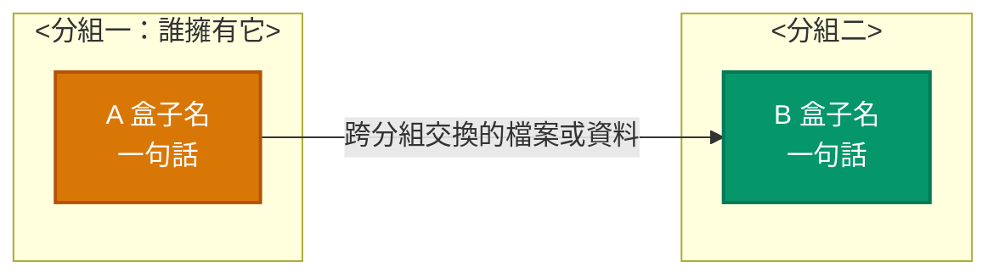

# <專案名> 概念地圖（黑盒層級）

最後確認：<MM/DD>

本檔只回答「有哪些盒子、各自的 Input 與 Output、盒子之間怎麼接」。盒子裡面怎麼做，指向出處，不在這裡重述。

## 1. L0：整個系統

```
<輸入> → [ 系統 ] → <輸出>
```

| 邊界 | 內容 |
| --- | --- |
| <不可違反的規則 1> | <說明與出處> |

## 2. L1：黑盒與資料流



## 3. 各黑盒的契約

### A 盒子名

| 項目 | 內容 |
| --- | --- |
| Input | <輸入> |
| Output | <輸出> |
| 保證 | <對外保證什麼> |
| 內部 | <子盒或細節在哪份文件的哪一節> |
| 程式 | `目錄/`、`目錄/檔案.py` |

#### A1 子盒名（選用，L2）

| 項目 | 內容 |
| --- | --- |
| Input | <輸入> |
| Output | <輸出> |
| 保證 | <保證> |
| 程式 | `目錄/子目錄/` |

## 4. 修改本檔的規則

- 討論中確定盒子、契約或連線有變，先改本檔再繼續，並更新「最後確認」。
- 每個盒子只寫四項；數字、公式、欄位清單留在出處。

<!--
格式約定（build.py 靠這些解析，改格式要同步改 build.py）：
- 第一個 `# ` 標題是專案名；「最後確認：」後面接日期。
- 標題含 L0 的章節：整段文字原樣顯示在 L0 卡片。
- `### <ID> <名稱>` 是 L1 盒子，ID 為 1–3 個英數字元（首字母大寫）；`#### <ID> <名稱>` 是它的 L2 子盒。
- 盒子內的表格列：Input／Output／保證／內部／程式；其他列照順序顯示。
- 「程式」欄反引號裡的路徑會被檢查是否存在，並自動列出 L3 檔案；沒有斜線的檔名會相對於同欄的目錄解析。

畫法約定（沿用使用者偏好的圖，viewer 直接讀 mermaid 區塊，圖只有一個來源）：
- flowchart LR；左到右就是資料流。
- classDef 定顏色：fill 用 600 級色、stroke 用同色系深一級、白字、stroke-width:2px；每張圖最多 4 種，一種顏色一種角色。
  常用色票：輸入 #D97706/#B45309；運算 #2563EB/#1D4ED8；成果與檔案 #059669/#047857；專案或使用方 #0F766E/#115E59。
- `class A,B 名稱` 把盒子套上顏色；宣告寫在圖最前面、套用寫在最後，結構與樣式分開。
- `%% 圖例: 名稱=中文; …` 這行提供 viewer 的圖例文字。
- subgraph = 分組 = viewer 的欄位（由左到右依宣告順序），標題寫「誰擁有它」；沒有 subgraph 時 viewer 依連線自動排欄。
- 節點文字兩行：「ID 名稱」`<br/>` 一句話。
- 連線標籤只標跨分組的連線（交換的檔案或資料）；分組內顯而易見的不標。必要用實線，選用用虛線 `-.選用.->`。
- 順序：分組內的連線先寫，跨分組的後寫，回饋線（指回前面欄位的）最後寫。
- 放在某個 `### ` 盒子底下的 mermaid 區塊，是該盒 L2 子盒之間的連線。
-->
